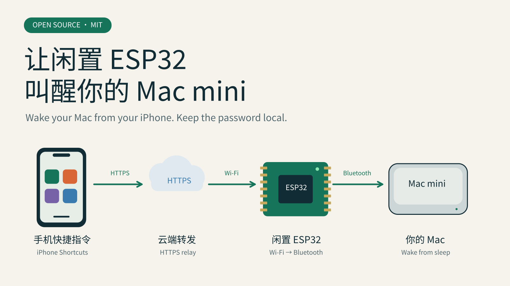
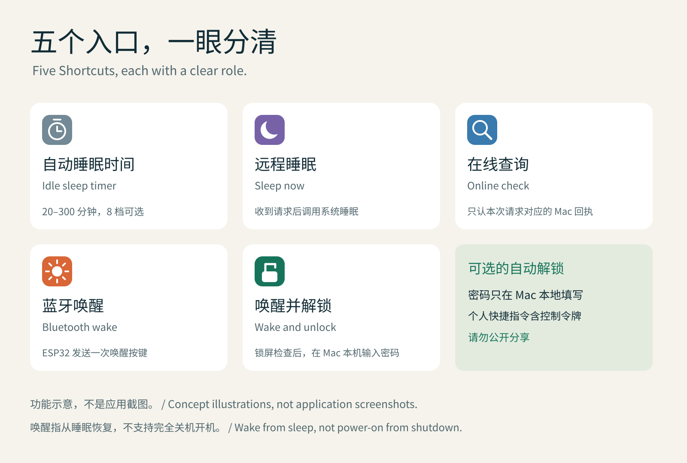
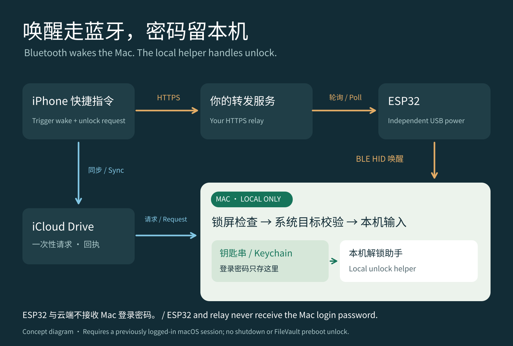
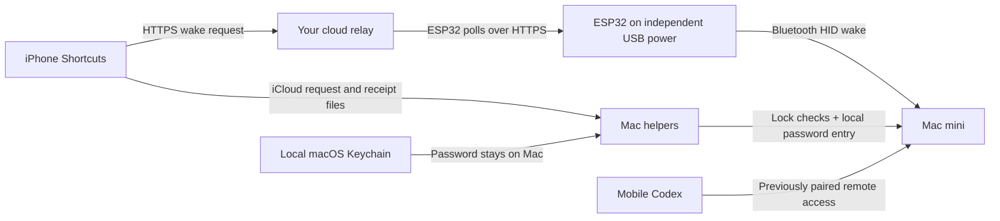

# ESP32 Mac Remote Control · ESP32 远程控制 Mac

用闲置的 ESP32、iPhone 快捷指令和本机助手，让 Mac mini 在需要时醒来，完成工作后再睡眠。支持远程睡眠、修改自动睡眠时间、蓝牙唤醒，以及经过锁屏检查后在 Mac 本地输入密码。

Reuse a spare ESP32 with iPhone Shortcuts and a local helper to wake your Mac mini when needed and put it back to sleep afterward. Includes remote sleep, idle-sleep timing, Bluetooth wake, and optional local password entry after lock-state checks.

## 想实现的生活方式 / Why this project

人在外面玩，也能用手机快捷指令唤醒家里的 Mac mini，再通过手机 ChatGPT 中的 Codex 远程连接，把需要电脑完成的事情交给 GPT。例如，让它在你授权的本机文件夹里寻找会议资料、整理摘要，或在你确认收件人和附件后，通过已连接的邮箱发送给你。闲置的 ESP32 成为一个小小的唤醒按钮，让家里的 Mac 按需工作。

While you are out enjoying your day, use an iPhone Shortcut to wake the Mac mini at home, then connect through Codex in the ChatGPT mobile app and delegate work that needs your computer. For example, ask it to find meeting materials in an authorized local folder, summarize them, or send them through a connected email service after you confirm the recipient and attachments. A spare ESP32 becomes a small wake button for an on-demand home computer.

远程 Codex 需要提前配对，桌面应用保持登录，Mac 醒着并联网；具体可用性取决于账号、应用版本和工作区设置。本项目提供唤醒与本机控制，不提供邮箱服务或绕过文件权限。参见 [Codex on mobile](https://learn.chatgpt.com/docs/mobile) 和 [Remote connections](https://learn.chatgpt.com/docs/remote-connections)。

Pair remote Codex in advance, keep the desktop app signed in, and keep the Mac awake and online while it works. Availability depends on your account, app version, and workspace settings. This project supplies wake and local-control components; email access and file permissions are configured separately. See [Codex on mobile](https://learn.chatgpt.com/docs/mobile) and [Remote connections](https://learn.chatgpt.com/docs/remote-connections).

## 功能 / Features

| 快捷指令 / Shortcut | 作用 / Behavior | 建议图标 / Icon |
|---|---|---|
| Mac 自动睡眠 / Mac Idle Sleep | 选择 20、30、50、60、120、180、240、300 分钟的系统空闲睡眠时间 / Set the system idle-sleep timer in minutes | 灰色计时器 / Gray timer |
| Mac 远程睡眠 / Mac Sleep Now | Mac 收到请求后请求系统睡眠；锁屏按 macOS 设置执行 / Request system sleep; locking follows macOS settings | 紫色月亮 / Purple moon |
| Mac 在线查询 / Mac Online Check | 要求 Mac 返回本次请求码；没有回复只表示未确认 / Require a fresh matching receipt; no reply means unconfirmed | 蓝色放大镜 / Blue magnifier |
| Mac 蓝牙唤醒 / Mac Bluetooth Wake | 云端请求 → ESP32 → 蓝牙键盘唤醒事件 / Cloud request → ESP32 → Bluetooth keyboard wake event | 橙色太阳 / Orange sun |
| Mac 唤醒并解锁 / Mac Wake and Unlock | 蓝牙唤醒后，Mac 本机校验请求与锁屏状态，再输入本机保存的密码 / Wake, validate the request and lock state, then enter the locally stored password | 绿色开锁 / Green open lock |

这里的“唤醒”指从睡眠恢复；不能让完全关机的 Mac 开机，也不能解开 FileVault 开机前的磁盘密码界面。系统空闲睡眠时间也不等于显示器熄屏时间。

“Wake” means resuming from sleep. It does not power on a fully shut-down Mac or unlock the FileVault preboot disk screen. System idle sleep and display-off timing are different settings.

## 工作原理 / How it works

配图为根据源码绘制的示意图，不含真实设备照片、账号、网络名称或凭据。 / These original source-based illustrations contain no real device photos, accounts, network names, or credentials.

查看文字连接流程 / Text connection flow

ESP32 需要接入你配置的 Wi‑Fi 并能访问转发服务，放在 Mac 蓝牙覆盖范围内。配置完成后可接独立 USB 电源，不需要用 USB 数据线连接 Mac。Mac 与 ESP32 不必在同一个局域网；安装脚本不会切换 Mac 的网络。

The ESP32 needs its configured Wi-Fi connection and access to your relay, and must stay within Bluetooth range of the Mac. After provisioning, it can use an independent USB power supply without a USB data connection to the Mac. The Mac and ESP32 do not need to share a LAN. Installation scripts do not switch the Mac’s network.

**Mac 登录密码只在 Mac 本地填写并保存在钥匙串里。** ESP32、转发服务和快捷指令都不接收登录密码。快捷指令包含控制令牌，属于你自己的私密配置，生成后不要公开分享。

**Enter the Mac login password locally; it is stored in the Mac’s Keychain.** The ESP32, relay, and Shortcuts never receive the login password. Generated Shortcuts contain control tokens and must remain private.

## 开始使用 / Get started

1. 准备 ESP32-CAM（本项目源于带 PSRAM 的经典 ESP32）、稳定 USB 电源、Mac、iPhone，以及同账号启用的 iCloud Drive / Shortcuts。其他 ESP32 型号需要自行验证。 / Prepare a PSRAM-equipped classic ESP32-CAM, stable USB power, a Mac, an iPhone, and iCloud Drive / Shortcuts on the same Apple account. Other ESP32 models need separate validation.
2. 按 [固件与转发服务教程](docs/firmware.md) 部署你自己的转发服务，编译固件，在本地填写 Wi‑Fi 设置并与 Mac 蓝牙配对。 / Follow the [firmware and relay guide](docs/firmware.md) to deploy your relay, build the firmware, enter Wi-Fi settings locally, and pair the ESP32 with the Mac.
3. 在项目目录运行 `python3 scripts/configure.py`，输入自己的转发地址和客户端令牌。配置保存在被 Git 忽略的 `.local/shortcuts.json`。 / Run `python3 scripts/configure.py` in the project directory; enter your relay URL and client token. Settings are saved in the Git-ignored `.local/shortcuts.json`.
4. 按 [睡眠与快捷指令教程](docs/sleep-shortcuts.md) 安装睡眠接收器，生成并导入自己的五个快捷指令。 / Follow the [sleep and Shortcuts guide](docs/sleep-shortcuts.md) to install the sleep receiver and generate/import your five Shortcuts.
5. 如果需要自动解锁，按 [本机解锁助手教程](docs/unlock.md) 编译、安装并授权，在 Mac 本地填写密码。这个功能可单独停用。 / For optional automatic unlock, follow the [local helper guide](docs/unlock.md), grant permissions, and enter the password on the Mac. You can disable this feature independently.
6. 先在电脑旁测试，再在独立供电、真实睡眠及手机蜂窝网络条件下验证。 / Test beside the computer first, then verify independent power, actual system sleep, and a phone on cellular data.

这是源码发布版，需要构建和本地设置；仓库没有携带任何人的现成账号、网络、令牌或密码。 / This is a source release requiring a build and local setup. It includes no preconfigured personal accounts, networks, tokens, or passwords.

## 已验证与待验证 / Validation scope

开发原型已完成真实锁屏后的本地密码输入，用户确认回到桌面；手机快捷指令也完成过亮屏并回到桌面的流程。USB 连接状态下的睡眠周期很短，不能单独证明纯蓝牙深度睡眠唤醒。独立电源下蓝牙重连已确认，随后一次请求也确认解锁，但该轮系统电源日志没有提供完整的睡眠→唤醒证据。

The development prototype successfully entered a locally stored password from a real lock screen, with the user confirming the desktop. An iPhone Shortcut also completed a screen-on-and-unlocked flow. The USB-connected sleep cycle was very short and does not independently prove Bluetooth-only wake from sustained sleep. Bluetooth reconnection on independent power was confirmed; a later request confirmed unlock, but that trial did not establish a complete system sleep→wake sequence in power logs.

公开版经过源码脱敏、编译与离线检查；不会把“发送了唤醒事件”写成“Mac 已经醒来”。每台电脑仍需实测。详见 [验证记录与复测步骤](docs/testing.md)。 / The public source is sanitized, built, and checked offline. Sending a wake event is not reported as proof that the Mac woke. Each setup needs an end-to-end test; see [validation and test steps](docs/testing.md).

## 项目内容 / Repository map

- `firmware/` — ESP32 蓝牙唤醒固件 / Bluetooth wake firmware.
- `relay/` — 自建云端请求转发 / Self-hosted cloud relay.
- `macos/sleep/` — 系统睡眠与状态接收器 / Sleep and status receiver.
- `macos/unlock/` — 本机钥匙串与锁屏检查助手 / Local Keychain and lock-check helper.
- `shortcuts/` — 快捷指令生成器 / Shortcut generator.
- `tests/` — 不触发真实睡眠或输入的离线检查 / Offline checks without real sleep or password entry.

本机解锁核心参考并改写自 [BLEUnlock PR #195](https://github.com/ts1/BLEUnlock/pull/195)，固定到文档中注明的提交；这不是上游官方版本。项目采用 MIT 许可，上游署名保留在 [第三方声明](macos/unlock/THIRD_PARTY_NOTICES.txt)。隐私边界见 [privacy.md](docs/privacy.md)。

The local unlock core is adapted from [BLEUnlock PR #195](https://github.com/ts1/BLEUnlock/pull/195), pinned to the commit listed in the notices. This is not an official upstream release. The project uses the MIT license and retains the [upstream notices](macos/unlock/THIRD_PARTY_NOTICES.txt). See [privacy.md](docs/privacy.md) for privacy boundaries.
